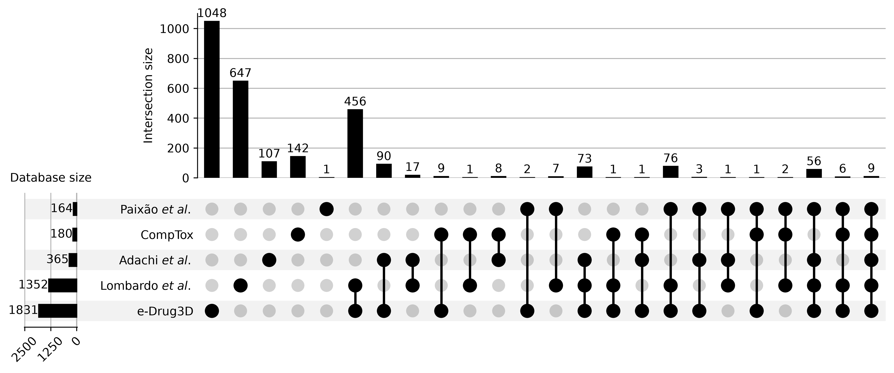
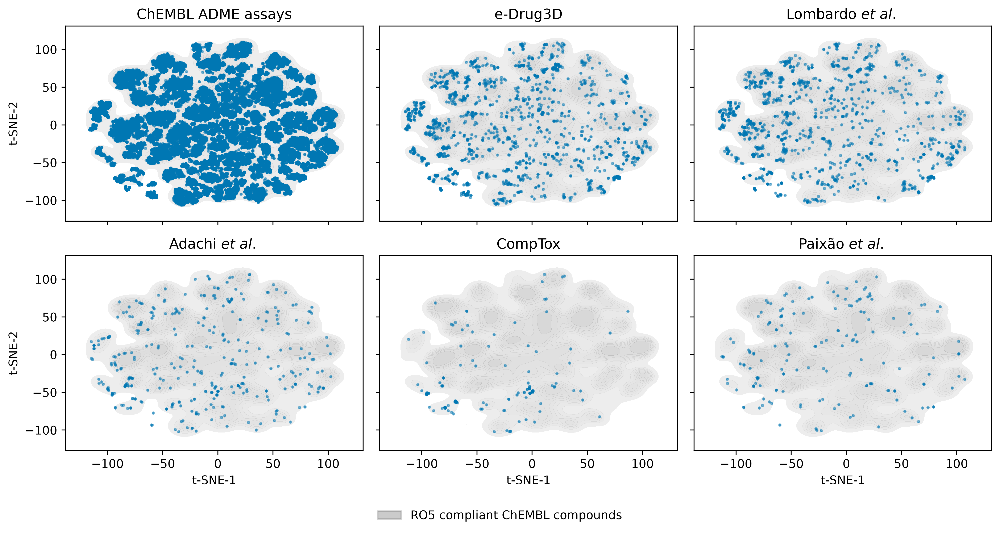
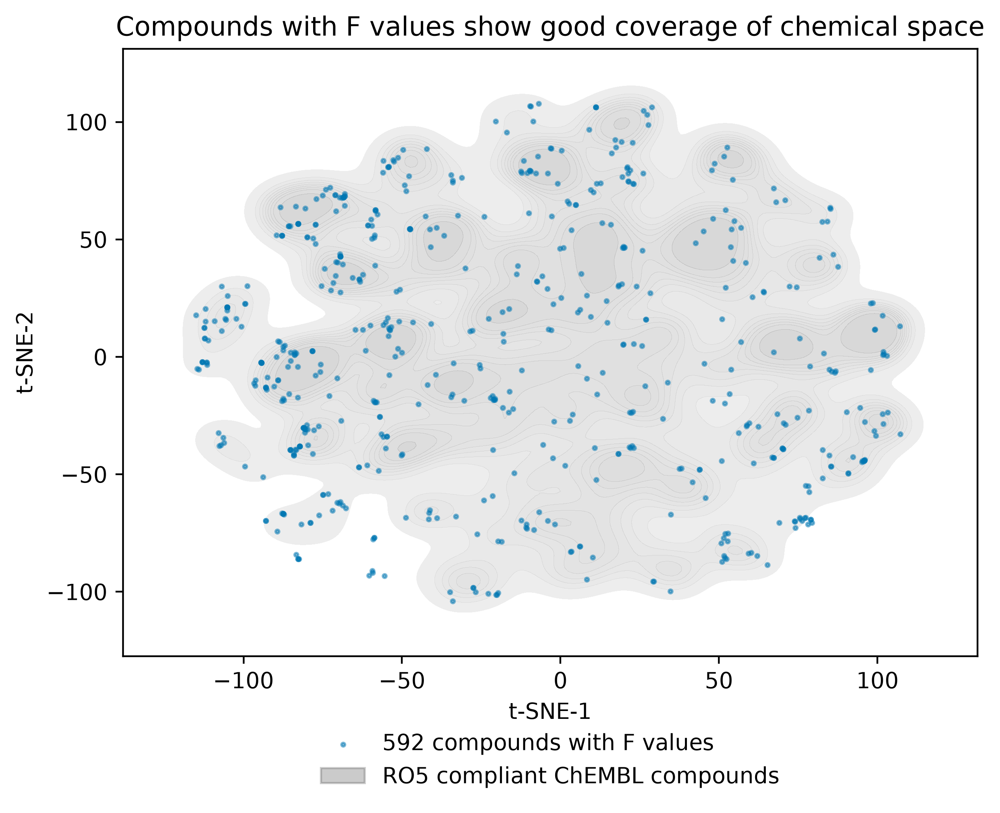

# An overview of human pharmacokinetic databases

Code and data for comparing publicly available human pharmacokinetic (PK) databases:

* `overview.ipynb`: generates overlap UpSetPlot and overview table
* `tsne.ipynb`: plots the chemical space of every database
* `requirements.txt`: lists the needed packages, run `pip install -r requirements.txt`

Run `overview.ipynb` before `tsne.ipynb`.

## Plots
Generated png and pdf files are in `plots` directory.

UpSetPlot showing overlap between databases

Overview of chemical space of databases vs ChEMBL Ro5 compounds.

Overview of chemical space of compounds with bioavailability data vs ChEMBL Ro5 compounds.
